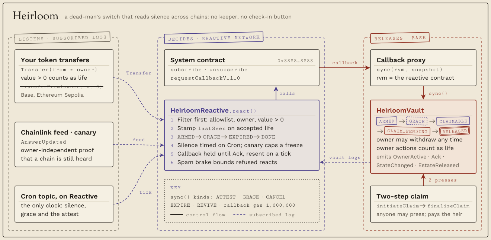

<div align="center">
  <h1>Heirloom ⏳</h1>
  <p><em>A dead-man's switch for a self-custody wallet. It reads silence across chains, so there is no keeper and no check-in button.</em></p>

  

  <p>Every on-chain and security claim below links to a transaction or a test. Testnet only so far: Reactive Lasna with Base Sepolia. The mainnet deploy is scripted and dry-run, not yet run.</p>

  <p><a href="https://edycutjong.github.io/heirloom/">Landing page</a> · <a href="https://edycutjong.github.io/heirloom/pitch/">Pitch deck</a> · <a href="https://edycutjong.github.io/heirloom/status/">Live status card</a> (GitHub Pages, published from <code>docs/</code> and <code>status/</code> once the repo is public)</p>

  <br/>

  [](https://dorahacks.io/hackathon/reactive-omni-buildathon/detail)

  <br/>

  
  
  
  [](https://opensource.org/licenses/MIT)
  [](https://github.com/edycutjong/heirloom/actions/workflows/ci.yml)

</div>

---

## 💡 The Problem & Solution

### The Problem

If you die with funds in a self-custody wallet, nobody gets them. A dead-man's switch fixes that, but the usual designs either need you to press a check-in button on a schedule (forget once and the switch fires on a living owner), or they watch one chain, or they rely on a keeper someone has to keep paying and trusting.

### The Solution

Heirloom treats **absence as the signal**. Your wallet keeps doing what it does; a Reactive Network contract watches your token activity on several chains and starts a countdown only when it stops.

- **No button.** Any value-carrying `Transfer` of an allowlisted token out of the owner's address on a watched chain counts as being alive.
- **Spoofs are refused.** A zero-value `transferFrom(owner, anyone, 0)` is the cheapest way for a stranger to fake or hide activity, so the filter is the first thing a `Transfer` log meets in `react()`, and every refusal is logged (`SpoofRefused`).
- **A canary guards against a deaf network.** An owner-independent Chainlink feed proves the network can still hear a chain; a gap in it freezes the countdown once, capped, instead of releasing on a silence nobody measured.
- **Small, reversible, claimed by the heir.** A vault on Base holds a capped deposit; the owner can withdraw at any time before release; release needs a two-step claim (`initiateClaim`, then `finalizeClaim` after `claimDelay`); anyone may press either step and the payout goes only to the heir.

States: `ARMED → GRACE → CLAIMABLE → CLAIM_PENDING → RELEASED`. Any watched owner activity (an allowlisted-token transfer or a vault action) during GRACE cancels it.

## 🏗️ Architecture & Tech Stack

| Layer | Choice |
|---|---|
| Reactive contract | `HeirloomReactive` on Reactive Lasna, built on `reactive-lib-omni` (`AbstractReactive`) |
| Destination | `HeirloomVault` on Base Sepolia, `AbstractCallback`, both guards on `sync()` |
| Tests | Foundry with the Reactive Network's Test Lib, via an Omni adapter in `packages/reactive-kit` |
| Scripts | TypeScript with viem, run with `tsx` |
| Status page | static `status/` (HTML + one ES module), read-only live chain reads plus the heir's claim panel |

The diagram source is [`docs/architecture.svg`](docs/architecture.svg).

## 🏆 Reactive Network Integration

The reactive contract is the engine, not an add-on: the loop does not exist without it.

| Capability | Where it is used |
|---|---|
| `SYSTEM.subscribe` / `unsubscribe` | enumerated per (chain, token, `Transfer`, topic1 = owner); the allowlist, spam brake, canary arming and teardown all change subscriptions at runtime |
| `requestCallbackV_1_0` | GRACE, CANCEL, EXPIRE, ATTEST and REVIVE callbacks to the vault, `gasLimit` 1,000,000 |
| CRON topics | the only clock (silence, grace, attest); one tier chosen at deploy, an optional faster tier can run during grace (unused on the testnet instances); attest is weekly on long-t |
| Self-unsubscribe | `react()` removes its own subscriptions on teardown; the finished demo instance holds 0 filters on Lasna (command in [DEMO.md](DEMO.md)) |
| Callback proxy guards | `sync()` checks both the proxy caller and the injected first argument (the reactive contract) |
| Reactive Test Lib | the whole loop (log → `react()` → callback) runs in `forge test` |

Measured platform facts, including what did not work as documented, are in [docs/DX-REPORT.md](docs/DX-REPORT.md).

## ⛓️ Live Deployment

Testnet instances, with every origin, reactive and callback hash in [DEMO.md](DEMO.md):

| | Reactive contract (Lasna) | Vault (Base Sepolia) |
|---|---|---|
| demo (T = 5 min) | [`0xa3d92EAefb2fc4C972d6Ee524c24F38A93739B8b`](https://lasna.reactscan.net/address/0xa3d92EAefb2fc4C972d6Ee524c24F38A93739B8b) | [`0x51365bb9560dDfA4236fd62d4eF2CB61f78edDBA`](https://sepolia.basescan.org/address/0x51365bb9560dDfA4236fd62d4eF2CB61f78edDBA) |
| long-t (T = 90 days) | [`0x80b56204D8860a6B46c08deCd9F01DD1881F9DC6`](https://lasna.reactscan.net/address/0x80b56204D8860a6B46c08deCd9F01DD1881F9DC6) | [`0x8C37E79420Cd16e46E4D9FFd4541a87FfFa4e7Be`](https://sepolia.basescan.org/address/0x8C37E79420Cd16e46E4D9FFd4541a87FfFa4e7Be) |

The demo instance ran the full scenario on live networks: grace twice, one cancel by owner activity, one expiry, the claim, teardown; 5 of 5 callbacks acknowledged (`evidence/status.json`), 0 resends (`evidence/demo-summary.json`). The testnet rows come from a build earlier than `HEAD`; mainnet deploys `HEAD`. **Try it yourself:** [`scripts/trigger-spoof.ts`](scripts/trigger-spoof.ts) fires a spoof from any wallet and you watch the reactive contract refuse it ([DEMO.md](DEMO.md#fire-a-fresh-loop-yourself)).

## 📊 Engineering Rigor

| Check | Result |
|---|---|
| Contract tests (`forge test`) | 104 passed, 0 failed |
| Shared kit tests (`FOUNDRY_PROFILE=kit forge test`) | 23 passed, 0 failed |
| TypeScript tests (`pnpm test:ts`) | 6 passed, 0 failed |
| Rows in `evidence/triples.csv` | 40 (22 with a callback leg, 18 reactive-only) across probe, short-T and long-T instances |

### Attacks defeated

| Control | Why it is load-bearing | Test |
|---|---|---|
| Zero-value spoof refused | a stranger cannot fake life with `transferFrom(owner, x, 0)` | `test_spoof_zero_value` (`test/HeirloomReactive.t.sol:23`) |
| Token allowlist | a worthless token's transfer cannot reset the clock | `test_spoof_not_allowlisted` (`:33`) |
| Spoof does not cancel a grace | a stranger cannot hold off a release | `test_spoof_in_grace_does_not_cancel` (`:254`) |
| Filter runs first | a refused react stays under a fixed gas ceiling, so spam is cheap to refuse | `test_refused_react_gas_ceiling` (`:57`) |
| Spam brake | refused reacts are billed; without a bound spam could drain the reserve and silence the contract | `test_spam_brake` (`:76`) |
| Freeze once, capped | a canary outage delays a release once and cannot be chained | `test_freeze_not_twice` (`:275`) |
| Both callback guards | only the proxy, relaying this reactive contract, can move the vault | `test_sync_direct_call_reverts`, `test_sync_wrong_rvm_reverts` (`test/HeirloomVault.t.sol:23`, `:29`) |
| Resend with backoff | a callback lost in an outage is retried, then slows down | `test_resend_delivers_after_outage` (`test/HeirloomReactive.t.sol:437`) |

### Known limits

1. **An active spam brake holds a grace.** Safety over liveness: spam can delay a release, never cause one.
2. **Approved spenders count as life.** Any value-carrying `Transfer` from the owner counts, including one made by a spender holding a standing allowance. That can only delay a release. Allowlist tokens that have no standing allowances.
3. **Cross-chain revive is best effort.** The vault owner's own action is the synchronous cancel.
4. **Top-up.** Fund the reactive contract with a transfer plus `coverDebt()` (or the system contract's `depositTo(address)`); a plain transfer does not clear its debt.
5. **Watch-set drift after an origin reorg.** An orphaned Base `setAllowlist(.., false)` can leave the reactive contract unsubscribed until the next `setAllowlist`. Documented at the ALLOWLIST branch of `react()`.
6. **No mainnet evidence yet.** Cost per month is not published: the measured window is too short, and a dollar figure needs a second price source. The canary gaps in `evidence/canary-gaps.json` cover about 23 h of Ethereum feeds (medians 3,612 s and 3,636 s); a multi-day measurement is still open.

## 🚀 Getting Started

### Prerequisites

[Foundry](https://book.getfoundry.sh/), Node 20+ and pnpm.

### Installation

```sh
git clone --recurse-submodules https://github.com/edycutjong/heirloom && cd heirloom
pnpm install
pnpm exec tsx scripts/trigger-spoof.ts --dry-run   # simulate a spoof against the live long-t instance
```

## 🧪 Testing & CI

```sh
forge test                       # contracts
FOUNDRY_PROFILE=kit forge test   # reactive-kit
pnpm typecheck && pnpm test:ts   # TypeScript
```

CI (`.github/workflows/ci.yml`) runs the same suites on every push; `.github/workflows/security.yml` adds gitleaks over full history and Slither, Dependabot keeps actions and npm deps current. See [SECURITY.md](SECURITY.md) and [CONTRIBUTING.md](CONTRIBUTING.md).

## 📁 Project Structure

```
src/             HeirloomReactive, HeirloomVault, shared types; src/probe/ (Day-1 spike), src/testnet/ (test token)
test/            Foundry suites: reactive, vault, hardening, probe
packages/reactive-kit/   shared MIT helpers: Test Lib adapter, absence watch, ack/resend ledger, triple logger, latency observer
scripts/         triples, status and cost recompute, trigger-spoof, mainnet deploy (dry-run)
script/          deploy and scenario shell scripts
status/          static status page
evidence/        triples.csv and the raw measurements
docs/            DX-REPORT.md, architecture.svg
```

## 🗺️ Roadmap

- [x] Spoof filter, allowlist, spam brake, canary freeze
- [x] Grace, cancel, expiry, two-step heir claim, teardown on live testnet
- [x] Shared `reactive-kit` and Test Lib adapter
- [ ] Mainnet instances (a 90-day one and a 48 h one)
- [ ] A REVIVE triple in the evidence
- [ ] Hardening: CI scans, SECURITY.md

## 📽️ Demo Materials

- Every transaction, with a command to fire your own: [DEMO.md](DEMO.md)
- Measured platform facts: [docs/DX-REPORT.md](docs/DX-REPORT.md)

## 📄 License

MIT. See [LICENSE](LICENSE).
